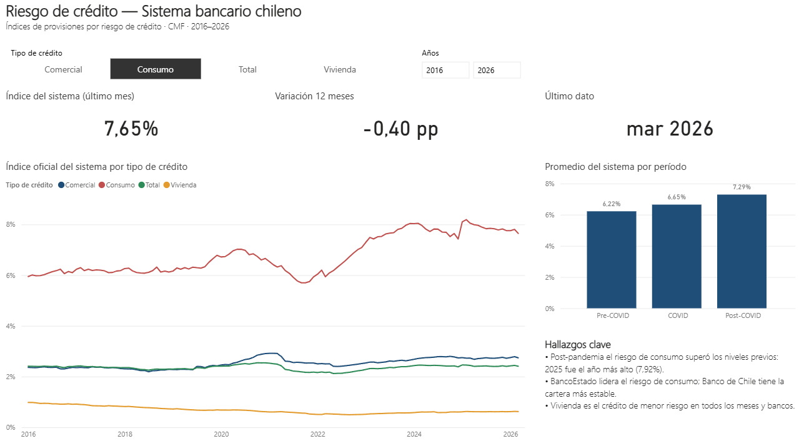
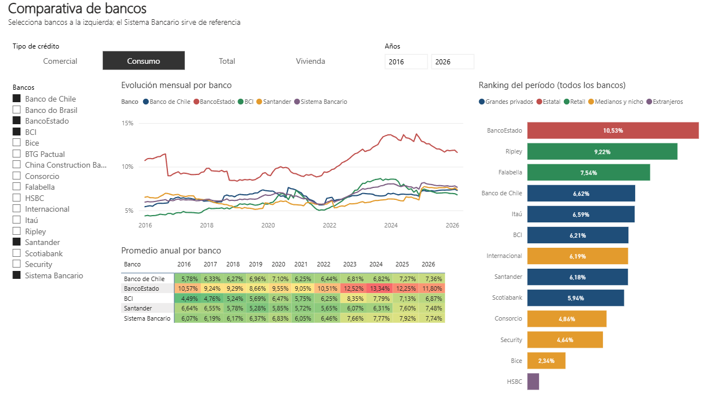
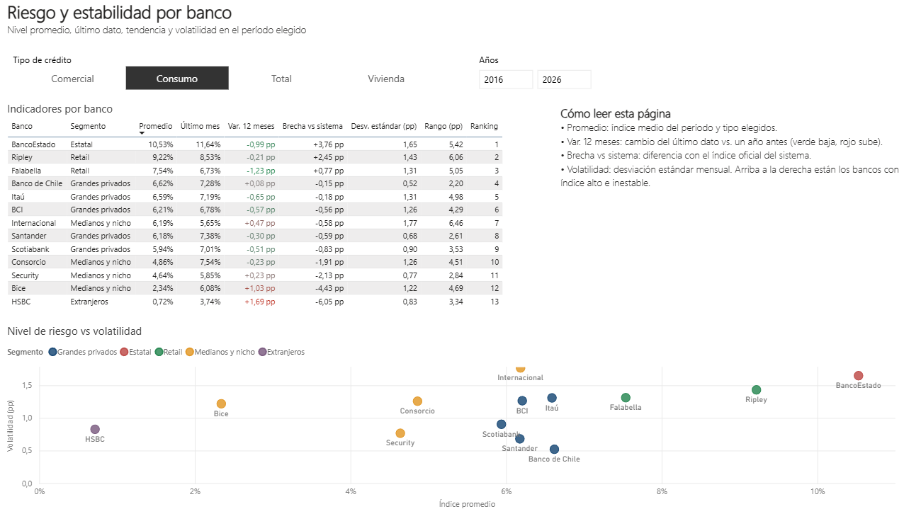

# Análisis de Riesgo de Crédito — Sistema Bancario Chileno

🔗 **[Ver dashboard en vivo](https://cmf-credit-risk-chile-mact.streamlit.app/)** · 📊 **[Versión en Power BI](#dashboard-en-power-bi)**

Análisis exploratorio de los índices de provisiones por riesgo de crédito del sistema bancario chileno entre 2016 y 2026, basado en datos públicos de la Comisión para el Mercado Financiero (CMF).

## Descripción

Este proyecto consolida, limpia y analiza 123 reportes mensuales publicados por la CMF (enero 2016 – marzo 2026), construyendo un dataset histórico que permite visualizar la evolución del riesgo crediticio por banco y tipo de cartera (comercial, consumo, vivienda).

El pipeline valida los encabezados de cada archivo antes de extraer los datos, para detectar cambios de formato de la CMF, y usa el índice oficial del sistema bancario publicado por la CMF para las cifras agregadas (en lugar de un promedio simple entre bancos).

## Estructura del proyecto

```
├── data/
│   ├── raw/              # Archivos Excel originales descargados desde CMF
│   └── processed/        # Datasets consolidados en CSV (por banco y *_sistema)
├── notebooks/
│   └── 01_eda.ipynb      # Análisis exploratorio de datos
├── src/
│   ├── descargar_archivos.py   # Script de descarga automática desde CMF
│   └── consolidar_datos.py     # Pipeline de consolidación y limpieza
├── dashboard/
│   └── app.py            # Dashboard interactivo (Streamlit)
└── powerbi/
    ├── RiesgoCreditoCMF.pbip   # Proyecto Power BI (modelo semántico + informe)
    ├── dim_banco.csv           # Tabla maestra de bancos y segmentos
    └── pantallazos/            # Capturas del informe
```

## Tecnologías utilizadas

- Python · Pandas · NumPy
- Matplotlib · Seaborn · Plotly
- Streamlit
- Power BI · Power Query (M) · DAX
- openpyxl · xlrd
- Git / GitHub

## Fuente de datos

**Comisión para el Mercado Financiero (CMF Chile)**  
Indicadores de Provisiones por Riesgo de Crédito de Bancos — publicación mensual  
https://www.cmfchile.cl/portal/estadisticas/626/w4-propertyvalue-29875.html

## Principales hallazgos

- **COVID: alza inicial y luego caída.** El índice de consumo del sistema pasó de 6.22% (promedio pre-COVID) a un peak de 7.02% a mediados de 2020, y luego cayó a 5.70% en septiembre–octubre 2021, el mínimo de la serie, en coincidencia con los retiros de fondos de pensiones y las ayudas estatales.
- **Post-pandemia, el riesgo de consumo superó los niveles previos.** Desde 2022 el índice promedia 7.47%, y 2025 cerró con 7.92%, el promedio anual más alto del período (peak mensual de 8.19% en febrero 2025).
- **BancoEstado lidera el riesgo de consumo** con un índice promedio de 10.53%, seguido por Banco Ripley (9.22%) y Banco Falabella (7.54%).
- **Banco de Chile tiene la cartera de consumo más estable:** su índice se movió en un rango de 2.2 puntos (5.42%–7.62%), el menor entre los bancos con historia completa. Le sigue Santander (2.6 puntos).
- **Vivienda es el crédito de menor riesgo** en el 100% de los meses y bancos analizados. El índice del sistema bajó de 0.94% (2016) a 0.62% (2026).
- **Divergencia reciente:** Banco Falabella bajó de 10.72% (dic. 2023) a 6.73% (mar. 2026), quedando por debajo de Banco de Chile (7.28%), y BancoEstado bajó de 13.77% (nov. 2024) a 11.64%. En el mismo período, Banco de Chile subió de 6.44% (promedio 2022) a 7.36% (promedio 2026).

*Un índice de provisiones más alto no implica necesariamente peor gestión: también refleja políticas de provisiones más prudentes y cambios normativos.*

## Dashboard en Power BI

Versión del análisis en Power BI, construida sobre los mismos CSV del pipeline.

**Resumen del sistema**


**Comparativa de bancos**


**Riesgo y estabilidad**


### Modelo de datos (esquema estrella)

| Tabla | Tipo | Contenido |
|---|---|---|
| `Provisiones` | Hechos | Una fila por banco, mes y tipo de crédito (7.980 filas), incluida la fila oficial del sistema bancario |
| `Bancos` | Dimensión | Tabla maestra (`powerbi/dim_banco.csv`) que unifica cambios de nombre y fusiones (Corpbanca → Itaú Corpbanca → Banco Itaú Chile; BBVA → Scotiabank Azul) y agrupa por segmento |
| `Calendario` | Dimensión | Calendario mensual con períodos pre-COVID, COVID y post-COVID |

- **Power Query:** une los CSV por banco y del sistema, despivota los tipos de crédito y convierte los números con cultura fija, para que la carga no dependa del idioma de Windows.
- **Medidas DAX:** índice, índice oficial del sistema, brecha vs sistema (pp), variación 12 meses (pp), último dato, ranking, desviación estándar y rango. La medida base devuelve vacío si el contexto mezcla tipos de crédito, para evitar promedios sin sentido.

**Cómo abrirlo:** abrir `powerbi/RiesgoCreditoCMF.pbip` en Power BI Desktop, ajustar el parámetro `RutaDatos` a la carpeta del proyecto (Transformar datos → Editar parámetros) y presionar **Actualizar**.

## Cómo ejecutar

**1. Instalar dependencias**
```bash
pip install pandas openpyxl xlrd matplotlib seaborn plotly streamlit requests beautifulsoup4
```

**2. Descargar los datos**
```bash
python src/descargar_archivos.py
```

**3. Consolidar los datos**
```bash
python src/consolidar_datos.py
```

**4. Ejecutar el dashboard**
```bash
streamlit run dashboard/app.py
```

**5. Explorar el análisis**  
Abrir `notebooks/01_eda.ipynb` en Jupyter Notebook.

## Autor

**Marcelo Adolfo Corro Troncoso**

---

*Este análisis es de carácter académico y fue desarrollado con fines de portafolio profesional. No constituye asesoría financiera ni representa la opinión de ninguna institución. Los datos utilizados son de acceso público y provienen de la CMF Chile.*
